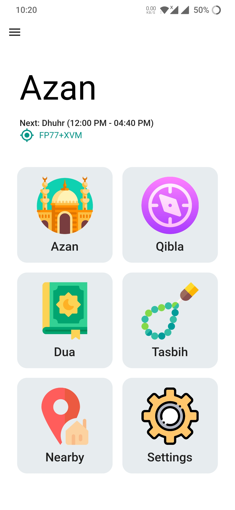
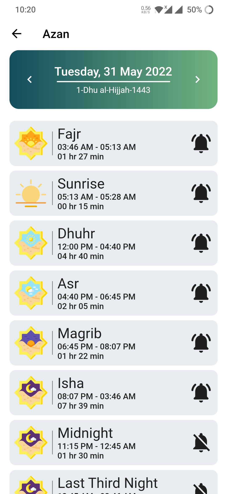
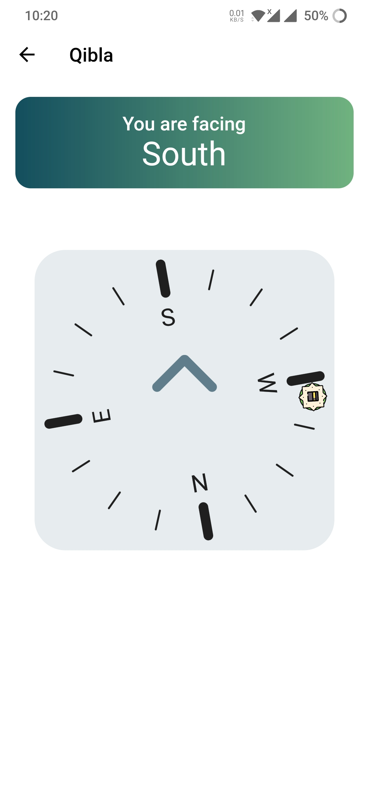
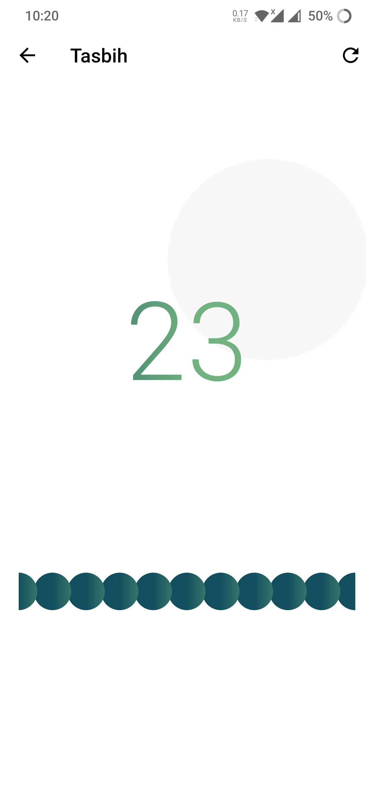
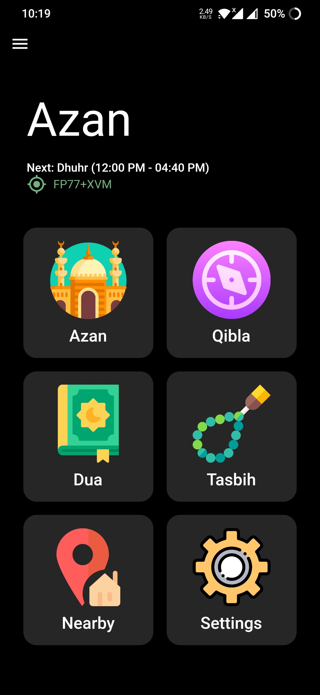
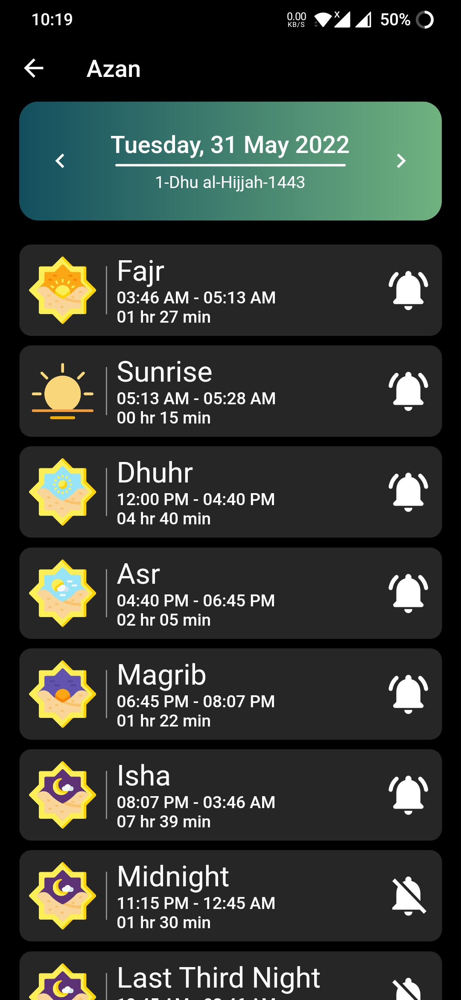
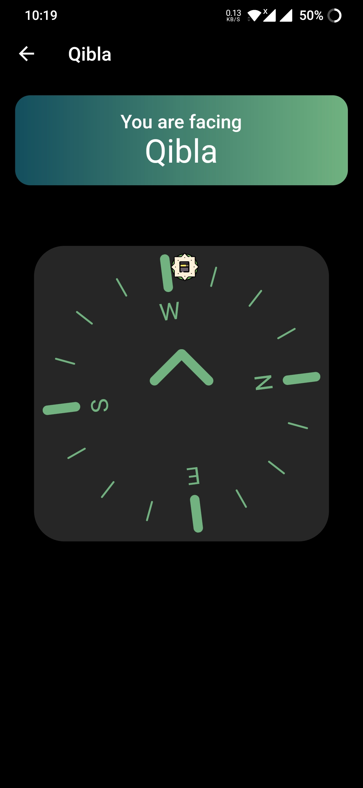
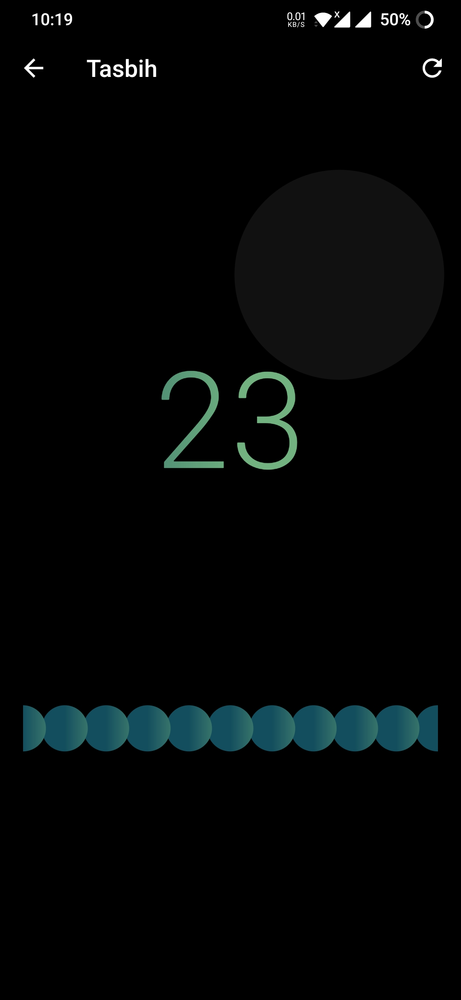

<div align="center">


# Adhanly

**Prayer times, duas, Qibla and tasbih — free, open-source and no ads.**

A Flutter app for the Muslim ummah: accurate Adhan timings, Qibla compass, essential duas and dhikr — privacy focused and fully transparent.

   

</div>

---

## 📱 Screenshots

<div align="center">

### Light mode
| | | | |
|:---:|:---:|:---:|:---:|
|  |  |  |  |

### Dark mode
| | | | |
|:---:|:---:|:---:|:---:|
|  |  |  |  |

</div>

## ✨ Features

### 🕌 Prayer Timings
- **Dashboard** — current prayer and next prayer at a glance
- **5 Fard prayer times** with the `adhan` calculation library
- **Tahajjud times** — midnight and last-third-of-night
- **Sunrise time** and timings for any date
- **Manual corrections** — add or subtract minutes to match local masjid times
- Choice of **calculation method**, **high-latitude rule** and **Asr madhab**
- Choose which Adhans to display

### 🧭 Qibla (Beta)
- Built-in **compass** pointing to the Qibla

### 🤲 Essential Duas
- Community-selected duas with sources
- **Favourites**, copy & share
- Translation / transliteration language choice
- Adjustable font sizes
- **Powerful deep search** — find any dua by keyword

### 🌍 More
- **Multi-language** — English (stable), Arabic (beta), Bangla (beta)
- **Light & dark themes**
- **Dhikr / Tasbih counter**
- Inspirational content
- **Privacy first** — zero data collection without user action (see [privacy policy](privacy-policy.md))

## 🚀 Getting Started

```bash
git clone https://github.com/Awaisdev01/Adhanly.git
cd Adhanly
flutter pub get
flutter run
```

- **Requirements:** Flutter 3.x, Dart ≥ 2.18
- Ships with a bundled `database.db` (duas, inspirations) — no remote setup needed
- Prayer calculation is fully offline via the `adhan` package
- Runs on **Android, iOS, Web and Windows** (see `android/`, `ios/`, `web/`, `windows/`)

## 📂 Project Structure

```
Adhanly/
├── lib/
│   ├── main.dart              # App entry
│   ├── screens/               # Home, adhan, duas, qibla, settings, welcome…
│   ├── models/                # Data models + localization base
│   ├── localizations/         # EN / AR / BN locale implementations
│   ├── helpers/  prviders/    # State (provider), utilities
│   ├── platform_dependents/   # Platform channels & services
│   └── widgets/               # Shared UI components
├── locales/                   # .arb translation sources
├── assets/                    # Database, fonts, images, animations
├── screenshots/               # Store screenshots (light + dark)
└── logos/                     # Branding assets
```

## 🛠️ Tech

| | |
|---|---|
| Framework | Flutter (Material) |
| State | `provider` |
| Prayer maths | `adhan` (offline calculation) |
| Location | `geolocator` + `geocoding` |
| Hijri dates | `hijri` |
| Storage | `sqflite` + `shared_preferences` |
| Animations | `lottie`, `flutter_svg` |

## 🙏 Credits

Based on the open-source **Minimal Adhan** project by **Muhammad Fahid** (v2.4.1), continued here as **Adhanly**. Thanks to the original author and every contributor of the open-source libraries it depends on.

## 📄 License

This is a continuation of the open-source Minimal Adhan project; the upstream project's terms apply to its original code.

---

<div align="center">

*May Allah accept it* 🤲

</div>
